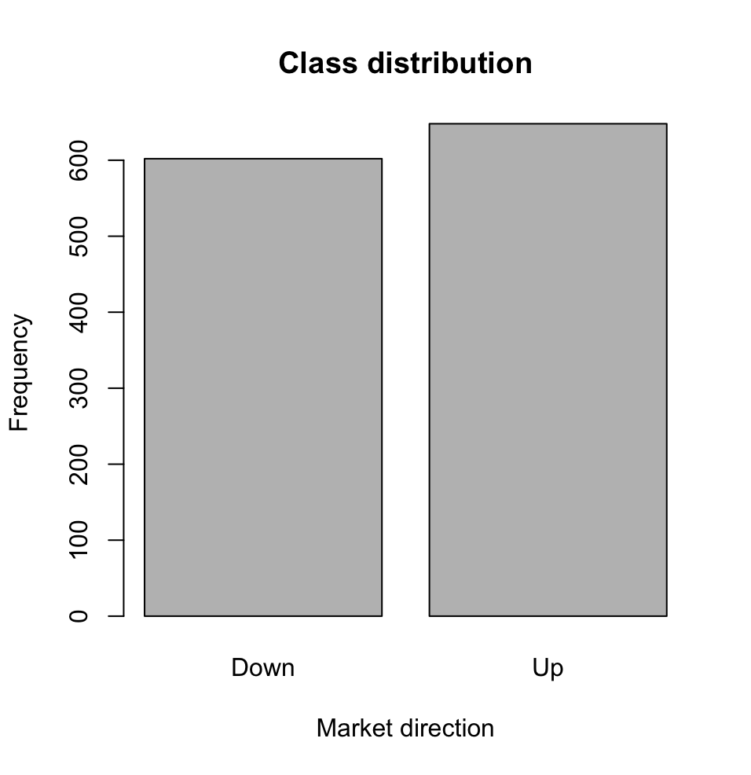
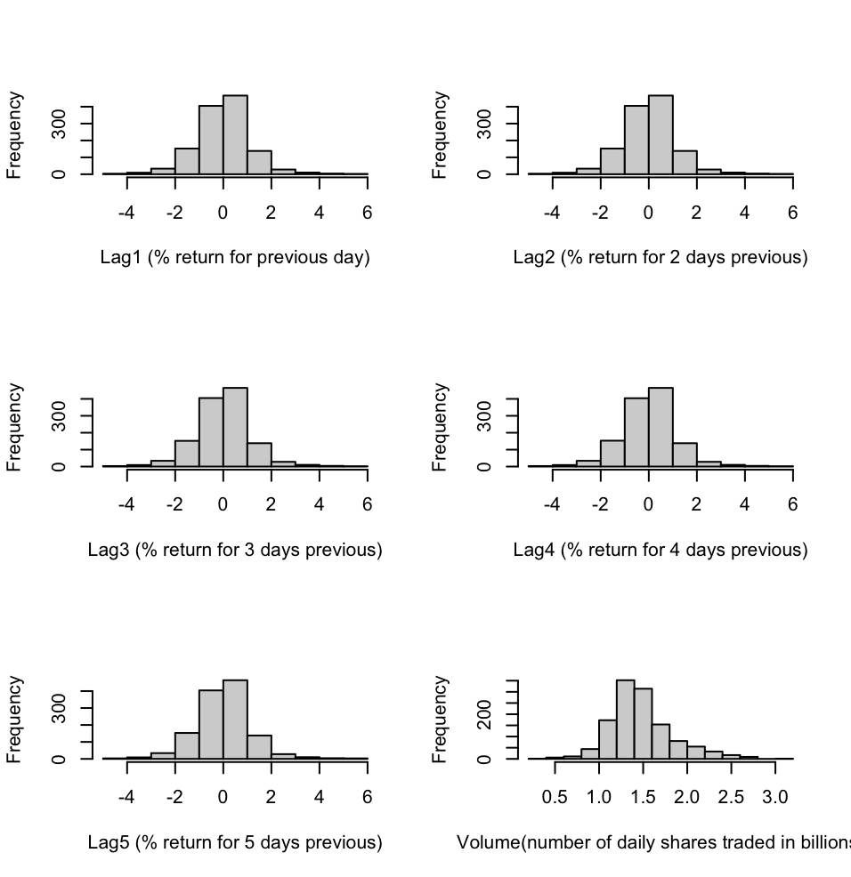
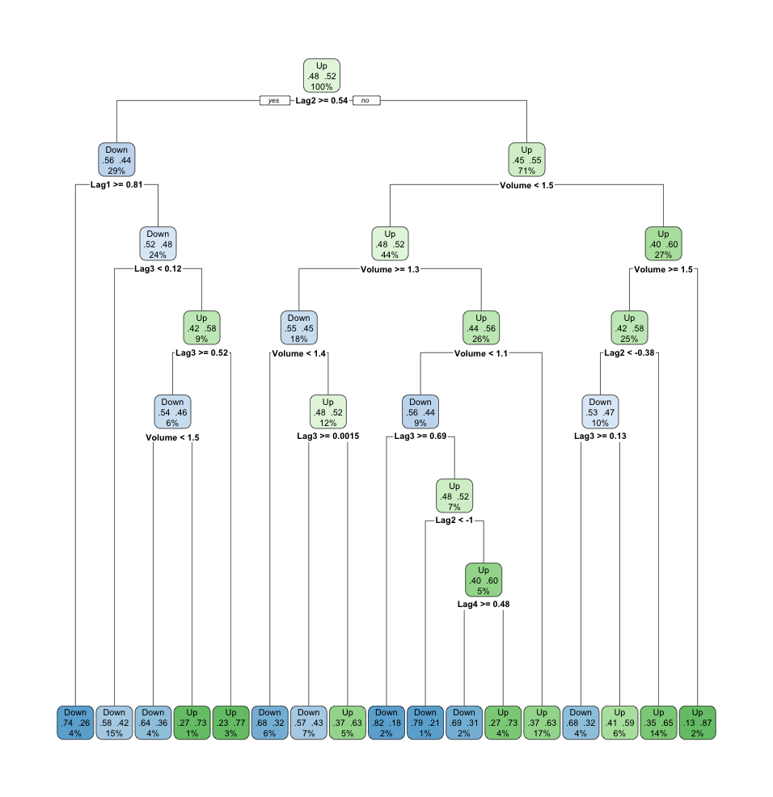
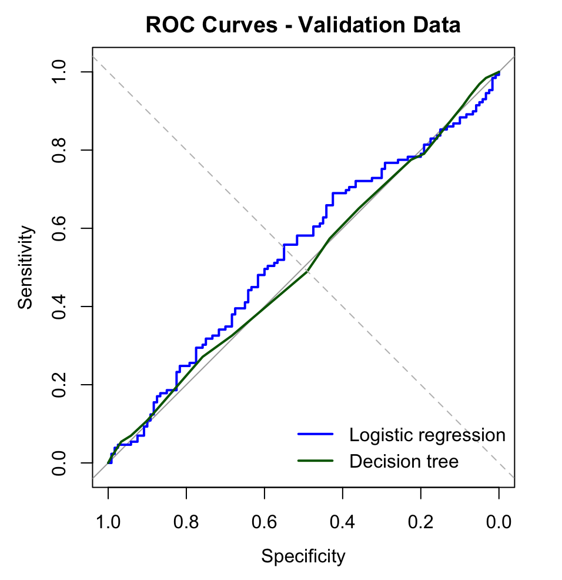

# Stock Market Direction Prediction: Logistic Regression vs Decision Tree

## 1. Overview

This project predicts whether the S&P 500 will go Up or Down on a given day using the previous five days' returns and trading volume.

It compares two classification models: Logistic Regression (a statistical model) and Decision Tree (a machine learning model) to evaluate whether the more flexible machine learning approach performs better.

## 2. Dataset

The analysis uses the `Smarket` dataset from the `ISLR2` R package.

### Variables

| Variable | Meaning |
|---|---|
| Year | Year in which the observation was recorded |
| Lag1–Lag5 | Percentage returns of the S&P 500 over the previous five days |
| Volume | Number of shares traded (in billions) |
| Today | Percentage return on the current day |
| Direction | Market direction, classified as Down or Up |

The target variable is `Direction`. The predictors used in both models are `Lag1`–`Lag5` and `Volume`. `Today` and `Year` are excluded from the models.

## 3. Exploratory Data Analysis

### Class Distribution

The bar plot shows the distribution of Up and Down market movements in the dataset.



### Predictor Distributions

Histograms are used to visualize the distributions of the five lag variables and trading volume.



### Correlation Analysis

The correlation matrix was used to examine relationships between the numerical variables and identify potential multicollinearity among predictors.

```text
          Year    Lag1    Lag2    Lag3    Lag4    Lag5   Volume   Today
Year     1.000   0.030   0.031   0.033   0.036   0.030    0.539   0.030
Lag1     0.030   1.000  -0.026  -0.011  -0.003  -0.006    0.041  -0.026
Lag2     0.031  -0.026   1.000  -0.026  -0.011  -0.004   -0.043  -0.010
Lag3     0.033  -0.011  -0.026   1.000  -0.024  -0.019   -0.042  -0.002
Lag4     0.036  -0.003  -0.011  -0.024   1.000  -0.027   -0.048  -0.007
Lag5     0.030  -0.006  -0.004  -0.019  -0.027   1.000   -0.022  -0.035
Volume   0.539   0.041  -0.043  -0.042  -0.048  -0.022    1.000   0.015
Today    0.030  -0.026  -0.010  -0.002  -0.007  -0.035    0.015   1.000
```

The lag variables show relatively weak correlations with one another, suggesting limited linear relationships among these predictors.

## 4. Model Implementation

Two classification models were trained using the same predictor variables.

### Logistic Regression

Logistic Regression was implemented using R's `glm()` function with a binomial family. It estimates the probability of the market moving Up or Down.

### Decision Tree

The Decision Tree model was implemented using the `rpart()` function. It classifies market direction by recursively splitting the data based on predictor variables.

### Decision Tree Visualization

The following plot illustrates the decision rules learned by the Decision Tree model.



## 5. Model Evaluation

The dataset was divided into 80% training data and 20% validation data. Both models used a probability cutoff of 0.5 to classify market direction.

The models were evaluated using:
- **Accuracy:** Overall proportion of correct predictions.
- **Sensitivity:** Ability to correctly identify Up movements.
- **Specificity:** Ability to correctly identify Down movements.
- **AUC:** Ability to distinguish between Up and Down movements across different classification thresholds.

### Performance Comparison

| Metric | Logistic Regression | Decision Tree |
|---|---:|---:|
| Cutoff | 0.5 | 0.5 |
| True Negatives (TN) | 24 | 52 |
| False Positives (FP) | 96 | 68 |
| False Negatives (FN) | 27 | 55 |
| True Positives (TP) | 102 | 74 |
| Accuracy | 50.60% | 50.60% |
| Sensitivity | 79.07% | 57.36% |
| Specificity | 20.00% | 43.33% |
| AUC | 0.5371 | 0.5055 |

### ROC Curve Comparison

The ROC curves compare the performance of both models across different classification thresholds.



## 6. Conclusion

Both models achieved the same validation accuracy of approximately 50.6%. Logistic Regression had higher sensitivity and a slightly higher AUC, while the Decision Tree had higher specificity. However, both models had AUC values close to 0.5, which indicates limited ability to distinguish between Up and Down market movements. Overall, neither model demonstrated strong predictive performance on the validation dataset.